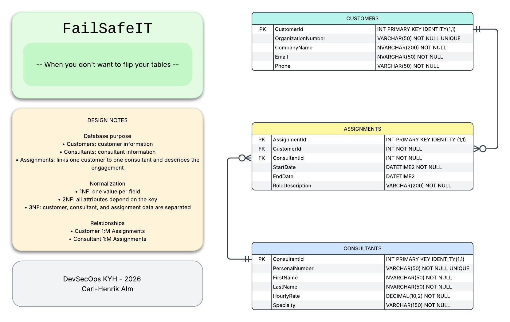

# FailSafeIT Database Project

## DevSecOps KYH-2026

### Author
Carl-Henrik Alm

---

# Project Overview

This project was developed as part of the DevSecOps KYH-2026 program.

The objective was to design, implement, and document a relational database solution for the fictional consulting company **FailSafe IT**. The company previously managed customers, consultants, and assignments using spreadsheets and required a structured SQL Server database capable of maintaining data integrity while supporting future growth.

The solution consists of three related tables:

- CUSTOMERS
- CONSULTANTS
- ASSIGNMENTS

The database was implemented using Microsoft SQL Server and includes table creation scripts, test data, and SQL queries demonstrating data retrieval and manipulation.

---

# Entity Relationship Diagram (ERD)

The ERD illustrates the relationships between:

- Customers
- Consultants
- Assignments

Each assignment connects one customer to one consultant.

## Relationship Structure

- One Customer → Many Assignments (1:M)
- One Consultant → Many Assignments (1:M)

---

# Database Normalization

The database design follows the principles of Third Normal Form (3NF).

## First Normal Form (1NF)

The database satisfies First Normal Form because all columns contain atomic values and there are no repeating groups or multivalued attributes. Each field stores only a single value.

## Second Normal Form (2NF)

The database satisfies Second Normal Form because all non-key attributes are fully dependent on the primary key of their respective table. No partial dependencies exist.

## Third Normal Form (3NF)

The database satisfies Third Normal Form because no non-key attribute depends on another non-key attribute. Customer information is stored only in the CUSTOMERS table, consultant information only in the CONSULTANTS table, and assignment information only in the ASSIGNMENTS table. This eliminates unnecessary duplication and reduces the risk of update anomalies.

---

# SQL Implementation

The SQL solution is divided into three main sections.

## DDL (Data Definition Language)

The DDL section creates the database structure and enforces data integrity through:

- Primary Keys (PK)
- Foreign Keys (FK)
- UNIQUE constraints
- CHECK constraints
- Identity columns for automatic ID generation

The database consists of the following tables:

- CUSTOMERS
- CONSULTANTS
- ASSIGNMENTS

Foreign Key constraints ensure referential integrity between customers, consultants, and assignments.

## DML (Data Manipulation Language)

The DML section populates the database with realistic test data:

- 11 customers
- 10 consultants
- 20 assignments

The sample data was designed to support testing of JOIN operations, aggregation functions, filtering, updates, and deletion scenarios.

An additional customer record was created without assignments to demonstrate deletion scenarios and referential integrity behavior.

---

# Query A - Consultants with High Hourly Rates

Lists all consultants with an hourly rate above 1200 SEK and sorts the results from highest to lowest hourly rate.

### Concepts Demonstrated

- SELECT
- WHERE
- ORDER BY

---

# Query B - Assignment Overview

Displays a complete assignment overview by combining data from multiple tables.

### The Result Includes

- Customer company name
- Consultant name
- Assignment start date
- Assignment end date

### Concepts Demonstrated

- INNER JOIN
- Relational data retrieval

---

# Query C - Active Assignments per Customer

Displays all customers and the number of active assignments associated with each customer.

The query uses `COUNT()` and `GROUP BY` to aggregate assignment data.

A `LEFT JOIN` is used to ensure that customers are still shown even if they have no active assignments.

The solution includes a date filter that counts only active assignments:

```sql
AND a.EndDate >= GETDATE()
```

If the date filter is commented out, the query instead counts all assignments regardless of whether they are active or completed.

```sql
-- Comment out 'AND a.EndDate >= GETDATE()' to count all assignments.
```

### Concepts Demonstrated

- COUNT()
- GROUP BY
- LEFT JOIN
- Aggregate functions
- Date filtering with GETDATE()

---

# Query D - Consultant Rate Update

Updates the hourly rate of a specific consultant by targeting a unique consultant record.

### Concepts Demonstrated

- UPDATE
- WHERE clause

---

# Query E1 - Remove a Prospect Customer

Deletes a customer who has no active assignments associated with their account.

This scenario could occur when a potential customer is created during negotiations but no active engagement exists.

### Concepts Demonstrated

- DELETE
- Referential Integrity
- Conditional record removal

---

# Query E2 - Remove a Former Customer

Deletes a customer whose assignments have all been completed.

Because the ASSIGNMENTS table contains a Foreign Key reference to CUSTOMERS, the completed assignments must first be removed before the customer record itself can be deleted.

This demonstrates how referential integrity protects the database from orphaned records.

### Concepts Demonstrated

- DELETE
- Foreign Key Constraints
- Referential Integrity
- Parent-child relationships

---

# DevSecOps Reflection

## Security (Sec)

### How Can SQL Injection Be Prevented?

SQL Injection can be prevented by never concatenating user input directly into SQL statements. Instead, parameterized queries should be used.

Parameterization separates the SQL command structure from the user-supplied data by using placeholders such as `@Email`. The SQL statement is compiled before the user input is inserted, causing the input to be treated strictly as a literal value rather than executable SQL code.

Additional protection can be achieved through input validation and the Principle of Least Privilege (PoLP), ensuring that database accounts only have the permissions necessary to perform their intended tasks.

---

## Operations (Ops)

### How Can Searches Remain Fast When the Database Grows?

If the database grows to thousands of customers and millions of assignments, indexes should be created on frequently searched columns such as `OrganizationNumber`.

Indexing allows SQL Server to locate rows efficiently without scanning entire tables, significantly improving query performance.

Example:

```sql
CREATE INDEX IX_Customers_OrganizationNumber
ON CUSTOMERS (OrganizationNumber);
```

---

# Technologies Used

- Microsoft SQL Server
- SQL Server Management Studio (SSMS)
- Lucidchart
- GitHub

---

# Conclusion

The project demonstrates relational database design, normalization, referential integrity, SQL querying, and basic DevSecOps principles.

The resulting database provides a structured and scalable foundation for managing customers, consultants, and assignments within FailSafe IT.

---

# Entity Relationship Diagram (ERD)

